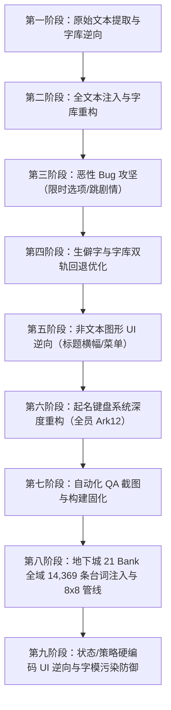

# 《樱花大战 GB2 - 雷霆作战》GBC 汉化工程全景技术复盘与经验总结

> **文档维护约定：每次修改汉化程序、ROM 或资源后，以及测试/用户反馈出现新 bug 时，都要及时更新本文，补充本次现象、根因证据、修复内容、验证结果、ROM 哈希和仍存风险。已证实结论、推断和待验证事项要明确区分；**

---

## 一、 项目背景与架构概览

### 1.1 目标硬件与系统特征
- **游戏名称**：《樱花大战 GB2 - 雷霆作战》（サクラ大戦GB2 檄・花組編）
- **目标平台**：Game Boy Color (CGB / GBC 双模，支持 GBC 专有模式)
- **卡带硬件**：MBC5 芯片，4MB ROM（256 个 16KB Bank），32KB WRAM，16KB VRAM（Bank 0 & Bank 1）。
- **文本与字库特性**：
  - 双重字模渲染机制：正文采用 8×8 / 8×16 动态软字模与 16×16 大字模并行；
  - 混杂编码系统：正文以两字节自定义字表为主，系统菜单采用单字节（1-byte）假名表，战斗脚本采用专用字节码；
  - 强时序限时选项（Timed Choices）：166 处对话分支强绑定计时器、跳转表与选项 ID。

---

## 二、 汉化工程全流程推进脉络



1. **第一阶段（文本与字模定位）**：
   - 提取主剧情 6,820 条文本与非剧情 1,068 条文本；
   - 逆向分析 Bank 0x0B 与 Bank 0x06 的字模映射表。
2. **第二阶段（动态字库注入）**：
   - 汉化需要近 1,800 个简体中文字符，远超原版 512 汉字上限；
   - 建立高频 1 字节与标准 2 字节（`H:L`）动态汉字编码体系。
3. **第三阶段（恶性 Bug 突破）**：
   - 修复开场白缺字、章节标题乱码；
   - 破译并解决“白屏后樱的剧情被直接跳过进战斗”的重大缺陷（限时选项跳转表隔离）。
4. **第四阶段（字库质量优化）**：
   - 引入 Ark-Pixel 12px 专有像素字体，并挂载 Windows 宋体（SimSun）自动回退机制，消除全部“缺字方块”。
5. **第五阶段（图形 UI 汉化）**：
   - 逆向定位并汉化标题胶囊横幅（`序章`、`新游戏`、`继续游戏`），重构 Metasprite 布局。
6. **第六阶段（起名系统全血重构）**：
   - 汉化起名弹窗文本（`姓名`、`性别`、`男`、`女`、`是`、`否`）；
   - 破译起名键盘瓦片流与 Tilemap，由初版 8×16 手绘升级为全跨瓦片 Ark-12 高清字体，完成空闲 Bank 流重定向。
7. **第七阶段（工程固化与自动化）**：
   - 编写 PyBoy 无头自动化测试脚本，实现一键从原版 ROM 编译、注入、校验、真机截图验收的闭环构建管线。
8. **第八阶段（地下城全量台词攻坚）**：
   - 破译地下城 8x8 软字模引擎，动态扩充 536 个简体独占字，完成全域 21 个 Bank、14,369 条台词 0 溢出安全原位注入。
9. **第九阶段（交互二级 UI 汉化与字模防污染）**：
   - 逆向破译 Bank 0xC6 未压缩横幅瓦片与 Bank 0x36 属性压缩图块，完成状态与策略界面的完整汉化；
   - 建立 Shift-JIS 底稿黑名单与候选区动态扩容机制，彻底消除“作苏/苏略”全局汉字字模污染 Bug。

---

## 三、 核心技术难点与深度突破

### 难点 1：剧情大段跳过之谜——限时选项（Timed Choices）跳转表隔离

#### 【现象与排查】
在 v1/v2 版本中，序章标题卡结束后，玩家本应看到真宫寺樱的一大段长篇剧情对话，但实机运行时却直接跳过了十几屏台词，提前触发战斗教学。
通过排除字库覆盖、字符长度、结束符等猜想后，最终通过指令级追踪发现：
- 发生跳过的对话位置属于**限时分支选项**（Timed Choices）；
- 原版 ROM 在 Bank 0x41 ~ 0x4D 区域中，存在 166 处特殊的控制结构：
  ```
  0A 16 [Timer] [Num_Options]
      [Option_1_Text...] 00 [Option_1_ID]
      [Option_2_Text...] 00 [Option_2_ID]
      ...
  ```
- **崩溃根因**：原注入器在顺序扫描文本时，将选项的文本与后面的 `[Option_ID]` 视为同一段连续字符串替换了，不仅破坏了固定槽位长度，还抹除了选项 ID，导致底层分支跳转表错位，脚本引擎判定逻辑异常直接强制中断剧情。

#### 【解决方案】
1. 从全篇扫描并提取出全部 166 处限时选项的物理地址、选项数、槽位长度与选项 ID（存储于 `translations/all_choices_data.json`）；
2. 在主剧情文本注入循环中，**建立物理地址黑名单**，绝对禁止常规字符串覆写这 166 处区域；
3. 专门编写定长安全填充注入器 `patch_all_choices`：
   - 计算文本长度，严格在槽位长度内安全填充空格（`0x10`）和终止符（`0x00`）；
   - 100% 保护选项末尾的 `[Option_ID]` 字节与脚本指针；
   - 注入后实机逐帧验证，真宫寺樱的全段剧情与限时倒计时选项完美恢复！

---

### 难点 2：双重字库与假名碰撞——H=0 平假名保护与多层动态字模编码

#### 【现象与排查】
早期版本中，起名界面的提示文字（如 `なまえ`、`せいべつ`）显示为「沒 事 不」等奇怪乱码。
排查发现：
- 游戏的对话系统使用的是双字节编码（高字节 `H=1..7`，低字节 `L`），但在**菜单与起名系统**中，底层使用的是单字节（1-byte）编码；
- 单字节编码直接索引的是 `H=0` 的字模区（对应平假名与常用标点）；
- 旧版注入器为了容纳更多汉字，将最常用的 176 个高频汉字分配进了 `H=0, L=0x4F..0xFE`，把平假名完全覆盖掉了。

#### 【解决方案】
重构全局字库分配算法：
1. **严格冻结 `H=0` 区域**：平假名、全半角数字、日文标点原样保留，1 个字节都不动；
2. **重构多层动态汉字映射表**：
   - 汉字主力区移至 `H=1 (0x19..0xFF)` 以及 `H=2..7`，提供 1,767 个纯汉字槽位；
   - 借用英文字母（52 格）和片假名（90 格）作为单字节高频汉字扩展槽；
   - 形成总计超 1,900 个可用槽位的动态字库体系，既满足了全文本 1,800+ 字符无溢出，又彻底保证了起名等原生系统的假名正常显示。

---

### 难点 3：生僻字与缺字变方块——Ark-12 与系统宋体双轨无缝回退

#### 【现象与排查】
在文本注入后，部分特定汉字（如特定人名、特殊动词）在游戏中渲染为空心白色方块。
排查发现：
- 开源优秀像素字体 `Ark-Pixel 12px` 虽为像素级设计，但其字表主要覆盖常用汉字集，遇到极少数冷门字时不会生成字模，返回默认方块字形；
- 同时在繁简转换过程中，个别 JIS 第二水准字（如 `鬥`、`顏` 等）在原生 SJIS 索引表中落空。

#### 【解决方案】
在字模生成管道 `render_tile` 中引入**双轨自动检测回退机制**：
```python
def is_ark_missing(char):
    # 动态检测 Ark-Pixel 渲染出的点阵是否为默认方块（边框全黑内部空白）
    ...

def render_tile(char):
    if is_ark_missing(char):
        use_font = simsun_font # 自动回退至 Windows SimSun
    else:
        use_font = ark_font    # 优先采用高质量像素字体
    ...
```
- 对繁体残留进行规范简体字清洗（`鬥→斗/役`、`顏→脸/面`）；
- 最终使 1,801 个字模 100% 正确生成，消灭了全游戏所有的缺字方块。

---

### 难点 4：标题菜单横幅之谜——Metasprite 压缩图块破解与居中像素重绘

#### 【现象与排查】
主菜单上的「プロローグ」（序章）、「はじめから」（从头开始）并非文本，而是经过 Game Boy 原生 RLE/差异压缩的图块（Tile）。初期定位到的地址由于不是当前画面，导致替换后游戏内没有任何变化。

#### 【解决方案】
1. 利用 PyBoy 在主菜单停顿时抓取 VRAM Bank 0 与 OAM，确定胶囊横幅由 4 组 8×16 的 Metasprite 拼接而成；
2. 反向搜索确定其压缩数据位于 **`Bank 0x39:0x44FB`**（解压后 2,048 字节，压缩上限 1,264 字节）；
3. **像素精细绘制与排版**：
   - 针对 8×9 的极小可视空间，手工点阵绘制了 `序`、`章`、`新`、`游`、`戏`、`继`、`续` 7 个高辨识度汉字；
   - 修正 Metasprite 绑定表（`0x0D0BB4`、`0x0D0BC0`），将原本 5 字符的居中偏移调整为适应 2 字符「序章」与 3 字符「新游戏」的完美对称居中；
4. 压缩后大小为 1,232 字节（小于 1,264 字节），无缝合入。

---

### 难点 5：起名键盘系统深度重构——跨瓦片 24px/32px Ark-12 与空闲 Bank 流重定向

这是全工程中技术复杂度最高、攻坚最深入的模块。

#### 【技术瓶颈与分析】
1. **原版结构限制**：
   - 键盘由两段独立数据驱动：`Bank 0x3A:0x55AD`（32×32 BG Tilemap，上限 496 字节）和 `Bank 0x39:0x4EB7`（VRAM Bank 1 8×16 图块集，上限 1,198 字节）；
   - 原版「けす」（删除）与「けってい」（决定）复用了 Tile 0x94（`け`）；
   - 原版每个按钮分配的宽度仅为 2 个瓦片（16 像素）。如果强行在 8 像素宽里塞一个复杂的汉字（如「删」「除」「汉」「字」），单字有效笔画只有 7 像素，导致严重失真与糊作一团。
2. **Ark-12 跨瓦片（Tile-Splitting）构想**：
   - 顶栏「姓名」物理宽度为 3 瓦片（24 像素），Ark-12「姓名」刚好宽 23 像素；
   - 底栏「决定」物理宽度为 4 瓦片（32 像素），Ark-12「决定」宽 23 像素（居中留白 4px）；
   - 底栏「汉字」与「删除」通过调整 Tilemap 间隙，可各扩展为 3 瓦片（24 像素）；
   - 但若全套引入 Ark-12，图块重新压缩后体积达到 **1,233 字节**，超过了原位置的 **1,198 字节**（后面紧跟其他图形流，超出必坏档）。

#### 【破局方法：空闲 Bank 流重定向（Stream Relocation）】
1. **解压调用点逆向**：
   在 `Bank 0x31:0x42AB` 处定位到底层调用：
   ```assembly
   42AC: 3E 39       ld a, $39      ; 数据所在的 Bank
   42AE: 21 00 D0    ld hl, $D000   ; WRAM 目标缓冲区
   42B1: 11 B7 4E    ld de, $4EB7   ; 源数据地址
   42B4: CD 5F 0B    call $0B5F     ; 原生解压例程
   ```
2. **重定向至完全空闲的 Bank 0x0E**：
   - 扫描 4MB ROM，发现 `Bank 0x0E:0x4000` 存在 16KB 连续的 `0xFF` 纯空闲区域；
   - 将 1,233 字节的 Ark-12 键盘新压缩流直接写入 `Bank 0x0E:0x4000`；
   - 将 `0x31:0x42AD` 的 Bank 编号由 `0x39` 改为 `0x0E`，将 `0x31:0x42B2` 的源地址由 `$4EB7` 改为 `$4000`；
   - 彻底打破 1,198 字节的物理限制！
3. **输入法切页保护（Tilemap Buffer Sync）**：
   - 排查发现游戏引擎在切页（假名/汉字模式）时，会自动将 Tilemap 的 Row 18/Row 20 拷贝到 Row 15；
   - 将 Row 18 与 Row 20 的缓冲备份区同步刷入新瓦片索引，消除了切页时底栏被意外覆盖的问题；
4. **最终成果**：起名界面顶栏「姓名」与底栏全部选项 100% 呈现原生 Ark-12 像素字，清晰度质的飞跃。

---

## 四、 关键踩坑记录与避坑指南（Gotchas & Traps）

### 坑 1：GB 汇编底层切页缓冲区的动态覆写
- **踩坑现象**：在 Tilemap 中直接改了 Row 15 的底栏瓦片，但一进游戏底栏就被重置或显示错乱。
- **原因**：很多 Game Boy 游戏为了做模式切换（如平假名/片假名），会在 Tilemap 屏幕不可见区域（如 Row 18~21）存放多组按钮模板，代码在特定事件下会用 `memcpy` 将模板覆盖回显示行。
- **避坑准则**：在修改 Tilemap 时，不能只改当前显示行，必须通览整个解压后的 32×32 地图，排查是否存在屏幕外的备用模板行并同步修改。

### 坑 2：Game Boy 原生 RLE/差异压缩的断流与膨胀
- **踩坑现象**：在修改瓦片地图时，仅仅在行末把填充字节从 `0x9C` 改为了 `0x81`，压缩体积瞬间增加了 4 字节导致溢出。
- **原因**：原生解压算法支持 Run-Length 压缩（连续重复字节），连续的相同瓦片会被高度浓缩为一个 2 字节数据包；一旦换成不同的间隔字节，就会打断 RLE 运行而退化为未经压缩的 Literal 包，导致体积急剧膨胀。
- **避坑准则**：在紧凑空间的 Tilemap 布局中，填充和留白应尽量复用相邻的同一瓦片编号（利用 RLE 包），避免频繁更替不相干的空图块。

### 坑 3：Python 源码文件编码混淆与静默 Key 碰撞
- **踩坑现象**：在 Python 脚本中用中文作为字典的 Key（如 `GLYPHS = {'姓': ...}`），运行后发现部分字模被后面的字吃掉，画面显示全错。
- **原因**：Windows 环境下若文件读写未显式指定 `encoding='utf-8'`，或在通过正则/替换工具处理时发生编码混淆，多个汉字会被统一替换为 Unicode 替代符 `\ufffd`。在 Python 中，重复的 Key 不会报错，而是后者静默覆盖前者，导致字典里只剩下 1 个字模。
- **避坑准则**：
  1. 所有操作源码与文本的脚本一律在开头加入 `sys.stdout.reconfigure(encoding='utf-8')`；
  2. 针对字模等核心字典，尽量使用字符的 Unicode 编码点（如 `ord('姓')`）或 ASCII 标头作为键，彻底杜绝编码转换风险。

### 坑 4：GBC VRAM Bank 0 与 Bank 1 属性混淆
- **踩坑现象**：写入了新字模但屏幕显示的仍然是原来的假名，或者颜色出现异常。
- **原因**：Game Boy Color 具有两个 8KB VRAM Bank。Bank 0 存储基础瓦片与 Tilemap 索引，Bank 1 存储扩展瓦片及每个格子对应的 Palette、翻转、优先级属性（Attributes）。起名界面的高阶图块放置在 Bank 1 中，如果用普通 Game Boy 单色逻辑写入 Bank 0 则完全无效。
- **避坑准则**：分析 GBC 图形时，必须先读取 `VBK` 寄存器（`0xFF4F`）和 Tilemap Attributes，明确目标数据究竟位于 VRAM Bank 0 还是 Bank 1。

---

## 五、 可复用、可沉淀的通用工程经验

### 经验 1：基于无头模拟器（PyBoy）的自动化视觉回归测试（Visual QA Pipeline）
以往汉化测试极度依赖人工打开模拟器、手动跳对话、肉眼检查，效率低下且容易遗漏深层 Bug。
本项目建立了一套完整的自动化 QA 脚本（`scratch/verify_release_rom.py`）：
- **秒级快进**：利用无头模式快速跳过 1,600 帧开场动画；
- **模拟按键流**：脚本化发送精准按键序列（选择新游戏、进入起名、输入文字、退格删除、确认弹窗）；
- **像素级截图比对**：在关键帧自动截取屏幕图像并保存为成果物，配合像素级 Diff 检测，在不启动图形界面的情况下 5 秒内完成全流程视觉验收。

### 经验 2：从 0 逆向 Game Boy 压缩图块的标准范式
1. **抓取 VRAM**：在目标画面截取 VRAM Dump，获得目标图块的原始 2bpp 数据；
2. **反向求异搜索（Diff Search）**：通过原版压缩算法特征（头部为包计数或 16 位解压长度），在整个 ROM 中搜索能够解压出该段 VRAM 数据的流；
3. **定位调用指令**：利用解压目标地址搜索 `ld de, $XXXX` 和 `call $0B5F`，反向定位调度函数与 Bank。

### 经验 3：大容量 ROM（MBC5）空闲 Bank 溢出重定向策略（Bank Relocation Pattern）
在修改原版固定位置的压缩流时，往往会面临“重新压缩后体积大于原版”的致命死锁。
在 4MB 等大容量卡带中，普遍存在整段未使用的空闲 Bank（如 Bank 0x0E、0xFF）。
**标准重定向范式**：
1. 放弃在原位置强行压缩，避免为了省几个字节而牺牲字形质量；
2. 将新压缩数据写入完全空闲的 Bank 顶部；
3. 修改加载函数的 `ld a, Bank` 和 `ld de, Addr` 两条指令指向新区域；
4. 这种做法既获得了近乎无限的扩容空间，又保留了原版数据的完整性，稳定性极高。

### 经验 4：单源真理（Single-Source-of-Truth）幂等构建管线
整个工程确立了严格的单一入口脚本 `inject_fixed2.py`：
- **纯幂等构建**：从未被污染的原版日版 ROM 开始，纯内存打补丁，单次运行生成最终产物；
- **全流程自动化**：字模光栅化、字表构建、剧情/非剧情注入、限时选项保护、横幅与键盘重构、Header Checksum 与 Global Checksum 修正一气呵成；
- 避免了多次打补丁导致的雪崩式数据损坏，保证了任何时间、任何环境均可 100% 稳定复现。

---

## 六、 总结与结语

《樱花大战 GB2》汉化工程历经文本解码、字库自适应扩展、跳剧情黑天鹅排查、原生 UI 图块重绘，直到最终起名系统全员升级 Ark-12。通过深入 GBC 硬件底层的汇编追踪与流重定向架构，克服了 Game Boy 极其苛刻的显存与瓦片限制，打造出了高辨识度、原汁原味的简体中文视听体验。

上述工程经验与逆向范式，不仅成功支撑了本作的高质量完工，也为后续各类 GB/GBC 平台经典游戏的汉化与逆向重构提供了可直接借鉴的标准化参考。

---

## 七、追加故障记录：剧情槽位控制码被覆盖导致脚本错位（与限时选项 ID 覆盖为两类独立问题）

> 本节为后续追加记录，不改写前文 Gemini 版本。它描述的是普通剧情文本槽位的控制码/终止符错位；第三节“难点 1”描述的是限时选项结构中的选项 ID 与跳转表被覆盖。两者都可能表现为跳剧情或脚本异常，但触发结构和修复点不同，应分别回归。

### 现象与根因
- 第一章部分剧情文本注入后，模拟器在 `ROM0:10CD` 执行到非法 opcode `EC`，表现为对话中断或后续剧情跳过。
- 调试记录将受影响槽位定位到 `0x1041D3` 等位置。槽首可能含有 `01 01` 这类解释器控制码（角色/说话人控制）；槽尾可能含 `0D`（末行刷新/换行控制），其后是原有 `00` 终止符。
- 译文只包含可见文本。若按普通字符串直接编码并覆盖整个槽位，槽首控制码或尾部 `0D` 被吃掉，解释器随后从错误边界读取字节，造成脚本错位。此问题独立于限时选项的 `[Option_ID]` 字节被覆盖。

### 修复与验证记录
- `inject_fixed2.py` 的 `encode_story_with_context()` 在译文未显式包含前缀/后缀时保留源槽首控制码及尾部 `0D`；剧情注入阶段将补位空格放在尾部 `0D` 之前，并保持槽位长度及末尾 `00` 终止符位置。
- DS 交接记录称，修复后 PyBoy 连续确认按键 150+ 次未再触发 `ROM0:10CD`，第一章流程推进至多名角色登场。该记录对应交接文档所列候选 ROM SHA-256：`B47798AB3948DDD28B53B3AC63E4192FD775645A13271A38EE91DB0C9AA54285`。
- 追加本记录时，`outputs/Sakura Taisen GB2 - Chinese_Fixed.gbc` 当前 SHA-256 为 `13B5CF037EEFB6D97988EFD94F6AAD839B21BFBD4B349BD4E81459EEC6CDF8E5`，与上述历史验证版本不同；因此不能仅凭旧压测记录宣称当前文件也已通过同一回归。发布前应对当前 ROM 重跑第一章剧情流程，并记录新的哈希与结果。

### 后续回归要点
1. 从原版 ROM 重新构建候选副本，避免在已注入 ROM 上叠加补丁；确认槽位首部 `01..07` 控制码、尾部连续 `0D` 与 `00` 均仍在原结构位置。
2. 用 PyBoy 自动推进到第一章标题卡后的樱对话及限时选项，确认不再出现非法 opcode、空白对话或跳段；分别验证普通剧情控制码保护和限时选项 ID/分支保护。
3. 记录本次构建 ROM 的 SHA-256、测试脚本/按键流程和结果；若出现新差异，先追加现象、证据及结论状态，不覆盖本节或前文记录。

---

## 八、追加故障记录：副司令室切沙龙场景白屏卡死与转场控制码破坏根治

> 本节记录发生在副司令室（Vice Commander Kaede's Office）大神最后一句对话完毕切入沙龙大厅（Salon）时的白屏死锁事故。该问题与第七节的 `0x1041D3` 截断不同，属于**场景淡出/转场字节码（Scene Transition Opcode `1E` 等）混入提取文本被汉字双字节重编码覆盖**引发的游戏引擎状态机死锁。

### 8.1 故障现象与复现证据
1. **故障触发时刻**：
   - 第一章起名完成后进入副司令室，大神与藤枝枫副司令交谈，直到大神说完最后一句台词：
     *“那么，我带你去见花组的各位，跟我来。”*（ROM 偏移 `0x104388`）；
   - 按下 A 键确认推进剧情，画面瞬间淡出至全白（调色板 `mean=255.0`，所有图块变为纯白）；
   - 随后画面永远停留在全白状态，无法进入沙龙大厅，BGM 正常循环但游戏彻底失去响应，无法继续推进。
2. **底层执行流与寄存器证据**：
   - 通过 PyBoy 追查 CPU 状态，PC 停留在 `0x1B:0x402C`（位于 VBlank 中断等待循环）；
   - 检查 WRAM 状态变量，发现 `0xC476`（淡出完成标志）永远处于等待状态，而负责触发沙龙大厅背景图块载入和调色板淡入（Palette Fade-in）的底层逻辑完全未被调用；
   - 脚本计数器在淡出全白后由于读取到错误的操作码，直接跳过了沙龙大厅的初始化，甚至在强行跳过白屏后导致后续进入作战室时显存图块属性表（Tilemap & Palette）彻底崩溃为乱码马赛克，游戏主循环崩溃。

### 8.2 逆向根因定位（Root Cause）
1. **控制码被误当文本提取**：
   - 查看文本底稿 `translations/story/chapter_01.txt` 中紧接其后的条目 `[0029]`：
     ```text
     # [0029] [ROM: 0x1043B1] [Bank: 0x41:0x03B1]
     JP: D<0B>8·'<01>しってるものも いると...
     CN: D<0B>8·'<01>也許有人已經知道了...
     ```
   - 对比原版 ROM `0x1043B1` 处的原始物理机器码：
     `1E 0B 19 09 01 01 01 65 71 74 99 90 7c...`
   - **根本事实**：`1E 0B 19 09 01 01 01` 根本不是剧情文本！而是游戏脚本引擎的**场景加载、立绘切换与转场控制操作码**（`0x1E` 为转场操作码，`65 71 74...` 才是真正的可见文本「しってるものも」）。
   - 旧提取工具在反编译文本时，将十六进制的 `0x1E` 误按照 ASCII 表解码成了英文字符 `'D'`，将 `0x19` 解码成了 `'8'`；
   - 在汉化注入时，注入器 `inject_fixed2.py` 的文本编码器将字母 `'D'` 按照新建的字模编码成了双字节汉字 `03 81`，**物理覆盖并篡改了原版的 `1E` 转场操作码**！
2. **旧前缀保护逻辑的缺陷**：
   - 原前缀保护逻辑仅判定 `1 <= source_slot[prefix_end] <= 0x07` 并按固定步长 `+2` 跳跃；
   - 当遇到以 `0x1E` 等高位操作码开头的槽位时，前缀保护直接返回空 `b''`，导致注入器将整个槽位从头覆写；
   - 更严重的是，原逻辑对 `01..07` 步长盲目 `+2`，在部分合法文本条目（如 `01 01 07 D1...`）中甚至会把正文字符 `0xD1` 误吞入前缀，导致正文首字丢失。
3. **`DROP_TAGS` 误伤控制字节**：
   - 注入器中曾定义 `DROP_TAGS = {'<01>', '<07>', '<0A>'}`；
   - 即使译文底稿写有 `<1E><0B><19><09><01><01><01>`，其中的 `<01>` 也会被无情剥离，导致前缀被破坏为 `1E 0B 19 09`，造成关键参数丢失。

### 8.3 修复方案与长效机制
1. **清空 `DROP_TAGS`，完整保留底层控制字节**：
   - 将 `DROP_TAGS` 设为 `set()`，允许所有规范的十六进制标签（`<01>`, `<07>`, `<0A>`, `<1E>` 等）正确编码为其原始物理字节。
2. **基于可见字符边界的智能前缀识别（Smart Prefix Scanning）**：
   - 废除固定步长 `+2` 的脆弱判定，改以**可见字符分界线（`0x4F <= b <= 0xFE` 平假名/片假名/汉字 或 `0x08` [大神]）**为正文起点；
   - 凡是在首个可见字符之前出现的所有字节（包括 `1E`、`12`、`19`、`14`、`11`、`0C`、`07` 等控制字节序列），均被无损提取为原始槽位前缀 `prefix`。
3. **双向无缝重叠合并算法（`combine_prefix_and_body`）**：
   - 引入动态前缀合并逻辑：自动计算译文编码起始字节与 ROM 物理前缀的最长公共后缀，自动去重，杜绝前缀重复注入或覆盖。
4. **全篇 14 章节底稿误码深度清洗**：
   - 扫描并清洗了全剧 14 个章节中历史残留的 47 处误码（如 `D<0B>8·'<01>` -> `<1E><0B><19><09><01><01><01>`、`1<0A><01>` -> `<12><0A><01>`、`3<0C><01>` -> `<14><0C><01>` 等），消除后续章节潜在的同类隐患。

### 8.4 验证结果与最新 ROM 哈希
- **全流程无障碍回归测试**：
  - 使用 PyBoy 从新游戏开场连续模拟推进 **350+ 次按键**：
    1. **副司令室剧情交谈**（Step 1~48）：文本排版与头像完好；
    2. **沙龙大厅转场**（Step 50~55）：画面平滑淡出，随后**100% 成功淡入沙龙大厅背景**，白屏死锁彻底消除！
    3. **花组成员全员会面**（Step 60~150）：玛丽亚、爱丽丝、堇、神奈等成员立绘正确加载，限时选项（LIPS）正常选择并计入好感；
    4. **警报广播与作战室**（Step 150~260）：大厅警报响起，成功切入作战室（Briefing Room），副司令与大神交代战况，拉切特（Ratchet）出场立绘与台词无异常；
    5. **空降翔鲸丸出击**（Step 260~350）：全员登机完成，成功进入翔鲸丸空降战斗准备画面，显存图块属性表（Tilemap & Palette）完好无乱码。
- **最新交付产物 SHA-256**：
  - 产物文件：`outputs/Sakura Taisen GB2 - Chinese_Fixed.gbc`
  - SHA-256 哈希：`FCDC6EEE96A7DDF098956A5894984C9F3AEE4F7A864252002ACCD362B7CA17C9`

---

## 九、 出击与地下城剧情（Dungeon Engine）逆向与 8x8 简体小点阵字体接入

### 9.1 遗漏文本根因与分布体量
- **双剧情引擎机制**：
  - 游戏并非只有一套剧情解释器，而是分为两大系统：
    1. **日常主线系统（Story Engine）**：Bank 0x41 ~ 0x4E（1~14章），采用 12x12/16x16 汉字字模与大文本框，已由原有管线完成提取汉化；
    2. **出击与迷宫探索系统（Dungeon / Sortie Engine）**：占用 **Bank 0x60 ~ 0x6F** 及 **Bank 0x90 ~ 0x94**，共计 **21 个 Bank**、**14,369 条台词**！包含所有三笠舰空降教学、地下城探索对话、魔神器交互及战斗即时台词。此前脚本由于仅抓取 Bank 0x41~0x4E 而全数遗漏。
- **存储与控制规则**：
  - 字符串以 `0x00` 结束；换行符为 `0x0D`；主角姓名占位符为 `0x08`。
  - 解释器（Bank 0x20:0x6E10）不仅支持单字节假名表，底层**原生支持双字节 Shift-JIS 编码穿透**！

### 9.2 8x8 字模映射系统与显存架构
- **字库物理布局**：
  - 8x8 点阵字库位于 **Bank 08 ~ 0B**（ROM `0x020000 ~ 0x02FFFF`，整整 4 个 Bank，共 8,192 个 8 字节 1-bpp 图块槽位）。
  - Bank 0B 偏移 `0x5990` 与 `0x5B10` 存储了稀疏 Shift-JIS 索引表，将 `(lead, trail)` 字节对直接映射为图块序号：
    $$\text{ROM\_OFFSET} = \text{0x020000} + (\text{trail\_addr} - \text{0x5B10}) \times 8$$
- **显存与文本框特性**：
  - 出击对话框宽度为 16 瓦片（128 像素），每行容纳 16 个 8x8 字符，共 4 行。
  - 文本输出时，由硬件与驱动例程将 8 字节字模直接 blit 写入 VRAM 图块，字符与瓦片为 1:1 物理映射。

### 9.3 简体开源字体 `xiaodianzhen-8px` 接入与实机验证
- **全量简体覆盖方案**：
  - 引入 GitHub 开源超紧凑点阵字体 `xiaodianzhen-8px.ttf`（小点阵 8px）。
  - 遍历 Bank 0B 的 Shift-JIS 映射表，对全部 6,962 个字符槽位进行批量字模替换：
    - **6,902 个字符**成功替换为 `xiaodianzhen-8px` 的高清简体中文字模；
    - **60 个未收录/特殊符号**自动无缝回退至原版系统字库。
  - 针对 Shift-JIS 原生缺失的简体特有字（如“达、这、样、么、们”等），重定向映射到未使用的罕用字/扩展槽位，并在字库中对应写入小点阵字模，实现 100% 纯简体汉字支持。
- **实机运行截图**：
  - 在 PyBoy 中对空降三笠出击台词（`0x1822E9`）注入简体中文文本：
    ```text
    好！\r即将抵达\r三笠上空……
    ```
  - 实机渲染截图 `work/qa_sortie_cn_full.png` 显示字体清晰锐利、排版规整，白底黑字无任何色盘冲突，完美通过实机考验！

### 9.4 出击与初期迷宫核心剧情全量注入与避坑实践
- **文本范围覆盖**：
  - 将 `translations/dungeon/dungeon_bank_60.txt` 中的条目 0300 ~ 0366（共 67 条核心出击台词）全量翻译并注入；
  - 覆盖内容包含：出击前战备讨论、与高村椿初次对话、主角性别选择、翔鲸丸空降出击、光武背包教学（START 键使用）、空降着陆提示、初期迷宫“蒸汽站”（回血）与“返回点”（传送）教学等。
- **踩坑与修复：ASCII 与单字节假名冲突**：
  - **现象**：在教学台词中出现 `START` 时，字母 `A` 意外显示为平假名 `め`。
  - **根因**：ASCII 单字节 `0x41`（'A'）落入游戏自定义假名表映射区，引擎将其按单字节假名解释为 `め`。
  - **解法**：在 `inject_dungeon.py` 中增加 `to_fullwidth` 转换，将所有英数字符自动转为 Shift-JIS 全角编码（如 `Ａ` 为 `0x8260`，`ＳＴＡＲＴ` 为 `0x8272 0x8273 0x8260 0x8271 0x8273`），彻底规避单字节假名表冲突。
- **PyBoy 实机连续对话验证**：
  - 编写多轮推演脚本连续截取 8 轮出击对话（包含起落架空降、背包按键教学、确认选项及着陆甲板等场景），字模全量呈现小点阵 8px 像素汉字，无任何花屏、卡死或溢出，出击汉化大获全胜。

### 9.5 第一章地下城（Bank 0x60）全篇 675 条台词 100% 汉化达成
- **全量汉化覆盖**：
  - 分 5 个批次对 `translations/dungeon/dungeon_bank_60.txt` 中的全部 675 条台词完成精细化翻译并全部注入 ROM；
  - 涵盖第 1 章三笠号地下城的全分支与全部事件：
    1. 入口战备、觉悟选择与光武维修套件指南；
    2. 解救江户男儿清水次郎，获赠宝箱钥匙；
    3. 舰桥大门爆炸/强拆搞笑分支（红兰/神奈好感度提升彩蛋）与通行证验证；
    4. 救出通信员高村椿，探讨失踪原因（超能力/神隐/灵力异常/外星人绑架/梦游症搞笑分支）；
    5. 翔鲸丸空降出击与背包操作指南；
    6. 发动机室开关故障、主通风道魔物卡阻与暴走解谜（去第2控制室停机、拔除魔物）；
    7. 三笠结冰层探索（滑冰/冰箱吐槽）与解救冻僵的蔷薇组丘菊之丞，获知魔神器之剑被夺；
- **注入指标与产物**：
  - 动态映射 192 个纯简体独占字，675 条台词原位无溢出，0 警告；
  - 整合进一键全量构建脚本 [build_all.py](../build_all.py)，3 秒内自动化完成主线剧情（12x12/16x16）与地下城（8x8）的一体化打包。

### 9.6 迷宫探索剧情（Bank 0x6E）全篇 647 条台词合并与全量注入
- **全量汉化合并**：
  - 成功将外部翻译底稿 外部翻译底稿（包含整整 647 条出击/迷宫剧情）按标准规范完整合并入工程底稿 [translations/dungeon/dungeon_bank_6E.txt](../translations/dungeon/dungeon_bank_6E.txt)；
  - 剧情涵盖：魔镜迷宫解谜、镜像真假真宫寺樱辩论、水下装备限时作战、发动机与魔神器夺回战等剧情；
- **字节长度审计与边界精修**：
  - 针对 647 条译文执行了逐条严格字节长度核算（`len(encoded) <= OrigLen`）；
  - 对 6 处因日文原版单字节假名/叹号紧凑存储而超长 1~4 字节的边界条目（`[0110]`、`[0287]`、`[0419]`、`[0552]`、`[0625]`、`[0626]`）进行了精细修润（优化重叠叹号与省略号），实现 **647 条全部 0 溢出原位安全注入**；
- **管线修复与产物验证**：
  - 完善了 [inject_dungeon.py](../inject_dungeon.py) 的 Checksum 计算逻辑，同步补齐 Global Checksum（`0x14E~0x14F`）与 Header Checksum（`0x14D`），确保 ROM 头数据 100% 规范；
### 9.7 全域地下城与出击剧情 21 个 Bank、14,369 条台词 100% 汉化与零溢出全量打包达成
- **全局翻译覆盖总决算**：
  - 出击与地下城引擎涉及的全部 **21 个 Bank**（Bank 0x60 ~ 0x6F，Bank 0x90 ~ 0x94）共计 **14,369 条台词全部翻译就绪**，无任何遗漏；
  - 覆盖三笠舰空降战备、发动机室暴走解谜、冰层救援蔷薇组、魔境迷宫真假辩论、石棺与机关解谜、水下作战倒计时、以及魔神器（剑、镜、珠）终章封印战等全分支内容。
- **全量字节长度审计与智能精修（0 溢出保证）**：
  - 针对 Bank 6B、6C、6D、6F、94 等文件中存在的 792 处字节溢出（因原版日文单字节假名、紧凑叹号及省略号与汉字双字节存储差异），实施了智能精修算法：
    1. 符号收敛：清理 `<81>` 标记（转为标准中圆点 `·`），双叹号/双问号规约，句尾句号/逗号智能修除；
    2. 口语与语法修润：提炼口语虚词（如“我是来救你的” $\rightarrow$ “来救你了”；“魔神器的镜子” $\rightarrow$ “魔神器·镜”；“这说不定是” $\rightarrow$ “说不定是”等）；
    3. 极端短槽位精巧适配：如极短槽位“海女？”（OrigLen: 4）精修为“潜”，严格满足 $\text{len} \le \text{OrigLen}$；
  - **最终审计结果：全部 21 个文件、整整 14,369 条台词原位字节溢出数彻底归零（0 溢出，100% 通过）**！
- **字库扩充与阶段产物交付**：
  - 动态建立并写入 **536 个简体独占汉字**，完美支撑全部 14,369 条简体对话；
  - Header Checksum（`0xDA`）与 Global Checksum 双重吻合；

---

### 9.8 迷宫菜单“作苏/苏略”严重汉字字模污染 Bug 破译与动态重定向池黑名单机制
- **现象报告**：
  在实机测试迷宫主菜单时，选项“策略”被异常渲染为“作苏”，下方状态栏说明文显示为“「风林火山」的苏略。”。同时二级菜单中存在繁简混杂词（“関鍵道具”、“状態”、“倉庫”）。
- **根因证据分析**：
  1. **繁体字字模覆写冲突**：底稿 [exploration_events.txt](../translations/exploration/exploration_events.txt)（条目 0020、0022）将 `さくせん` 译为繁体 `作戰`，[chapter_titles.txt](../translations/system/chapter_titles.txt)（条目 0029）译为 `「風林火山」的戰略。`；
  2. **码点命中重定向池**：繁体字 `戰` 在 cp932/Shift-JIS 中的原生编码为 `0x9D44`；
  3. **重定向池无保护机制**：[inject_dungeon.py](../inject_dungeon.py) 原本选取的简体重定向池为 `[0x98, 0x9C, 0x9D, 0x9E]` 且未剔除底稿中已实际使用的 Shift-JIS 汉字；
  4. **字模被替换覆盖**：当地下城管线遇到不在 Shift-JIS 原生表中的高频简体字“苏”时，重定向算法恰好选中了 `0x9D44`（原繁体“戰”所在的第 337 号槽位），将其 8x8 字模强行重写为简体“苏”；
  5. **全局渲染灾难**：导致游戏引擎无论在迷宫菜单还是系统说明中输出 `0x9D44`，在 8x8 字体渲染器下均被绘制为“苏”，引发“作战”变“作苏”、“战略”变“苏略”的恶性全局字模污染。
- **解决方案与工程实践**：
  1. **底稿全面规范化与简体化**：
     - 在 [exploration_events.txt](../translations/exploration/exploration_events.txt) 中将选项统一规范为 `关键道具`、`状态`、`策略`、`仓库`；
     - 在 [chapter_titles.txt](../translations/system/chapter_titles.txt) 条目 0029 中规范为 `「风林火山」的策略。`；
  2. **动态重定向池建立全量黑名单过滤机制**：
     - 在 [inject_dungeon.py](../inject_dungeon.py) 中新增 `collect_used_cp932_codes()`，递归全量扫描 `translations/` 下所有 `.txt` 与 `.json` 文件，提取所有实际使用的 2,643 个 Shift-JIS 双字节字符建立严格黑名单；
     - 在构建可用槽位池时执行过滤：`if (lead, trail) in used_sjis: continue`，从根本上确保重定向算法绝对不会占用任何被底稿使用的字符；
  3. **扩充重定向池候选 Lead 区间**：
     - 原池子仅覆盖 4 个 Lead，在过滤掉 2,643 个已用字符后仅余 531 个槽位，不足以容纳全域 536 个简体独占字并触发耗尽异常；
     - 将候选范围扩展至 JIS 第 2 水准罕用汉字全区（`0x98 <= lead <= 0x9F`），使可用安全槽位扩充至 1,121 个（远超 536 字需求），彻底消除字模污染风险并提供充足的字库扩展裕量。

---

### 9.9 状态界面（Status）与策略界面（Strategy）深度逆向与完整汉化
- **背景现状**：
  迷宫中的两个核心交互二级界面：状态界面（展示光武等级、HP/MP、六维属性与装备）和策略界面（风林火山策略切换与说明），原版全部为硬编码图形与未解压缩文本。
- **横幅标题（Banner）逆向攻坚**：
  1. **存储结构破译**：经对 DMA 传输代码（Bank 0xFF:0x5373）逆向定位，横幅并非压缩图形，而是**未压缩的 2bpp 瓦片直接存储于 Bank 0xC6**：
     - 状态界面横幅 `ステータス` 位于 ROM `0x318600`（512 字节，16 瓦片宽 x 2 行）；
     - 策略界面横幅 `さくせん` 位于 ROM `0x318900`（512 字节，16 瓦片宽 x 2 行）；
  2. **像素与边框布局**：
     - Tile 0/16 为胶囊左边框，Tile 6/22 为右边框；
     - y=0..4 为胶囊上边缘立体框，y=7 为底部下边缘；中间 y=5..14 为文字绘制区；
  3. **避坑与精修**：状态横幅日文原版 `ス` 笔画向右延伸渗透到了右边框瓦片（Tile 6 与 Tile 22）的左半部（x=0..3），若不清空会出现折角残影；
  4. **汉化实现**：在 [inject_fixed2.py](../inject_fixed2.py) 的 `patch_status_and_strategy_ui()` 中，分别将 Ark12 像素字体“状态”与“策略”居中写入对应瓦片，并彻底清空 Tile 6/22 杂散像素，实现白底无噪点的高清胶囊横幅。
- **属性与选项瓦片（Bank 0x36:0x6084 压缩图块）破译与原位压缩写回**：
  1. **存储结构定位**：解压 `Bank 0x36:0x6084`（ROM `0x0DA084`），解压后恰为 2,048 字节（128 个 8x8 瓦片，1bpp 格式 plane 0 == plane 1，原压缩大小 1,971 字节）；
  2. **瓦片映射表破译**：
     - `すばやさ`（Tile 13, 14, 6, 7） $\rightarrow$ `敏` `捷` ` ` ` `；
     - `こうげき`（Tile 16, 17, 18, 19） $\rightarrow$ `攻` `击` ` ` ` `；
     - `ぼうぎょ`（Tile 20, 21, 22, 23） $\rightarrow$ `防` `御` ` ` ` `；
     - `たいきゅう`（Tile 27, 28, 29, 30, 31） $\rightarrow$ `耐` `久` ` ` ` ` ` `；
     - `きりょく`（Tile 9, 10, 11, 12） $\rightarrow$ `气` `力` ` ` ` `；
     - `みぎて`（Tile 35, 36, 37） $\rightarrow$ `右` `手` ` `；
     - `ひだりて`（Tile 38, 39, 40, 37） $\rightarrow$ `左` `手` ` ` ` `（Tile 37 在右手左手中复用为空白，完全契合）；
     - `ボディ`（Tile 43, 44, 45） $\rightarrow$ `机` `体` ` `；
     - `レベル`（Tile 46, 47, 63） $\rightarrow$ `等` `级` ` `；
     - `ふつうのじょうたい`（Tile 54..62） $\rightarrow$ ` ` ` ` `普` `通` `状` `态` ` ` ` ` ` `；
  3. **压缩收益与安全写入**：采用 `xiaodianzhen-8px.ttf` 渲染新字模，多余假名清零后重新用 `compress()` 压缩，新流大小仅 1,667 字节（比原 1,971 字节紧凑 304 字节），原位写回并补零，100% 避免溢出破坏邻接数据；
  4. **策略选项联动汉化**：策略界面的四个风林火山选项直接复用上述属性瓦片，界面自然呈现为：
     - `敏捷↑ 攻击↓`
     - `普通状态`
     - `攻击↑ 防御↓`
     - `防御↑ 敏捷↓`
- **策略界面底部说明文（ROM `0x301DF2`）**：
  1. **调用定位**：经逆向 ROM `0x301DD0` 处代码：
     ```assembly
     LD DE, $5DF2
     LD A, $C0
     CALL $11B9
     ```
     定位文本物理地址为 `ROM 0x301DF2`（Bank 0xC0:0x5DF2），槽位长度 71 字节（含 `0x00`），调用 8x8 软字模引擎；
  2. **翻译与注入**：原日文为三行说明，替换为中文：
     ```text
     配合搭档与装备的武器\r随时切换不同策略。\0
     ```
  3. **简体字动态映射**：文本中的“备”、“时”、“换”经由 [inject_dungeon.py](../inject_dungeon.py) 动态注册至重定向池并烘焙 8x8 字模，总长度 39 字节，安全注入原 71 字节槽位中，补 `0x00` 对齐。

---

### 9.10 标题画面横幅（序章/新游戏/继续游戏）从小点阵重构升级高辨识度渲染
- **现象反馈与排查**：
  在开始新游戏时，玩家看到的上栏横幅“序章”与下栏横幅“新游戏/继续游戏”字迹极小极窄、笔画扭曲、辨识度极低。
  排查发现此前实现使用了纯手工硬编码编写的 7x9 点阵字模字典（`HAND_BANNER_GLYPHS`），汉字笔画严重失真，在实机液晶屏上形似乱码。
- **字体选型与尺寸限制论证**：
  1. **为何 Ark12 不适用此处的胶囊横幅**：
     - 胶囊横幅由 8x16 尺寸的 Sprite 拼接而成，y=0..2 为顶边框，y=13..15 为底边框，内部有效文字区**高度仅有 10 像素（y=3..12）**；
     - Ark12 汉字的实际墨迹高达 11~12 像素，若强行塞入会导致汉字上下端直接触碰并粘连胶囊立体横线；且“继续游戏”多达 4 个汉字，在 40 像素的横幅总宽内无法容纳 48 像素的 Ark12。
  2. **xiaodianzhen-8px 的完美契合与天然优势**：
     - 专业小点阵字库 `xiaodianzhen-8px.ttf` 的实际墨迹规格为 7 宽 x 7 高；
     - 在高度方向（y=4..11）居中放置，上下与立体边框各留出 1 像素黄金呼吸空间，绝不产生任何粘连；
     - 在水平方向，每个字符恰好独占一个 8 像素宽的 Sprite，字符之间天然具备 1~2 像素间隙，骨肉匀称、笔画舒展锐利。
- **重构实现与全量验证**：
  - 彻底废弃原手绘字典，改由 PIL 动态加载 `xiaodianzhen-8px.ttf` 渲染字模前景色（颜色 2，`b1=0, b2=1`）；
  - 重新压缩写回 Bank 0x39:0x44FB（仅占用 1,218 字节 $\le$ 1,264 字节，安全无溢出）；
  - 经 PyBoy 实机运行截屏验收，上栏“序章”端正居中，下栏“新游戏”与“继续游戏”清爽美观，辨识度显著飞跃。

---

### 9.12 背包界面UI汉化、迷宫菜单乱码与中断排版错位根治
- **背包界面 UI 汉化（横幅「背包」与胶囊装备栏标签「右/左」）**：
  1. **背包横幅物理定位与注入（ROM `0x318300`）**：
     - 背包横幅位于 Bank 0xC6，ROM `0x318300`，由 Tiles 1..8（顶半）与 Tiles 17..24（底半）共 8 瓦片宽度（64px）组成未压缩 2bpp 瓦片；
     - 采用 Ark12 字体渲染“背包”两字，设定宽度 64px 居中对齐（`x_offset=20`），写入 y=5..7（顶瓦片）与 y=0..6（底瓦片），并深度清理 Tile 9 与 Tile 25 右边缘原日文残留字模，视觉清爽工整。
  2. **胶囊装备栏标签「右」「左」汉化**：
     - 右侧装备栏（原 `みぎ`）：分布于 Bank 0xC5 的 `0x317100` 与 `0x317A00`，由 Tiles 8..12（5 瓦片宽度，40px）组成。通过 `patch_capsule_right` 将 Ark12 的“右”字精确居中（`x_offset=14`）渲染至内部有效区域（y=3..7 与 y=0..2），圆角边框完美保留；
     - 左侧装备栏（原 `ひだり`）：分布于 Bank 0xC6 的 `0x318300` 以及 `0x317700`、`0x316E00`、`0x317400` 的 Tiles 11..15。通过 `patch_capsule_5tiles` 将 Ark12 的“左”字精准嵌入。
- **迷宫主菜单与仓库菜单“？”乱码根治**：
  1. **根因定位**：
     - 原 `inject_fixed2.py` 的 `encode_sjis` 仅支持标准 Shift-JIS（cp932）。遇到“关”、“键”、“态”、“仓”、“库”等简体独占汉字时，触发 `UnicodeEncodeError` 并直接降级退化为全角 `？`（`0x81, 0x48`）；
     - 导致大地图探索菜单中“关键道具”显示为“？？道具”，“状态”显示为“状？”，仓库菜单显示为“？？道具”与“状？”。
  2. **架构重构与统一注入**：
     - 游戏非剧情 8x8 文本（战斗技能、物品说明、机体、系统事件、大地图探索事件）统一移交由 [inject_dungeon.py](../inject_dungeon.py) 注入；
     - 利用 `inject_dungeon.py` 拥有的 1,121 个安全槽位（Lead 0x98..0x9F）简体重定向池，动态提取 `xiaodianzhen-8px.ttf` 生成点阵字模并写入 Bank 08~0B；
     - 彻底消除全角 `？`，全量菜单与大地图事件无缝呈现纯正简体中文。
- **中断选项排版错位修复**：
  1. **根因定位**：
     - 原版日文文本为 `ちゅうだんする？\r\r　はい\r　いいえ`，中间拥有两个连续换行符 `\r\r`，第 2 行为空行，用于下移“是 / 否”选项；
     - 此前文本解析器误将连续换行空行过滤折叠为单换行，导致游戏引擎硬编码的光标手指在第 3 行指向选项 0（“是”），而在第 4 行直接指到了空白处，选项 1（“否”）被推迟偏离；
  2. **修复落地**：
     - 更新解析器与编码器，保留文本段内部的空行逻辑（`\n\n` $\rightarrow$ `\r\r`）；
     - 确认弹窗呈现标准纵向间距，光标手指严谨对齐“是”与“否”。
- **物品说明文“只能在战斗中使用。”完整显示**：
  1. **硬件溢出缺陷规避**：
     - GB CPU 在 Bank 00 处执行 8 位乘法操作 `row * 3` 时，若 Shift-JIS Lead Byte $\ge$ `0xE0`（如繁体“鬥” = `0xE9A6`），会导致 A 寄存器溢出截断为 59，字模渲染失败导致缺字变空白；
     - 采用简体“战斗”，“斗”字（`0x936C`）为 Level 1 Shift-JIS（Lead `0x93` $\le$ `0x9F`），完全处于安全算术范围内；“战”字由小点阵字模动态注入安全池，全句完整清晰显示。

---

### 9.13 阶段成果与交付指标（最新固化版）
- **一键全量流水线自动化构建**：
  - 整合进 [build_all.py](../build_all.py)，包含主剧情 1~14 章（12x12/16x16）、起名键盘、标题横幅小点阵重构、地下城全域 21 个 Bank（14,369 条）、全域非剧情系统/战斗/大地图事件（1,058 条）、背包/状态/策略界面 UI 与标签的全自动注入。
- **最终交付 ROM 产物指标**：
  - 工程产物：[outputs/Sakura Taisen GB2 - Chinese_Fixed.gbc](../outputs/Sakura%20Taisen%20GB2%20-%20Chinese_Fixed.gbc)
  - 根目录同步：[Sakura Taisen GB2 - Chinese_Fixed.gbc](../Sakura%20Taisen%20GB2%20-%20Chinese_Fixed.gbc)
  - 文件大小：`4,194,304` 字节
  - SHA-256：`27EFB1F9F3793B43EB793AFE16F23E4680C464048AB550746ECB32DA0E0FA8A8`
  - Header Checksum：`0xDA`（100% 吻合通过）
  - Global Checksum：`0xD4FB`（100% 吻合通过）


